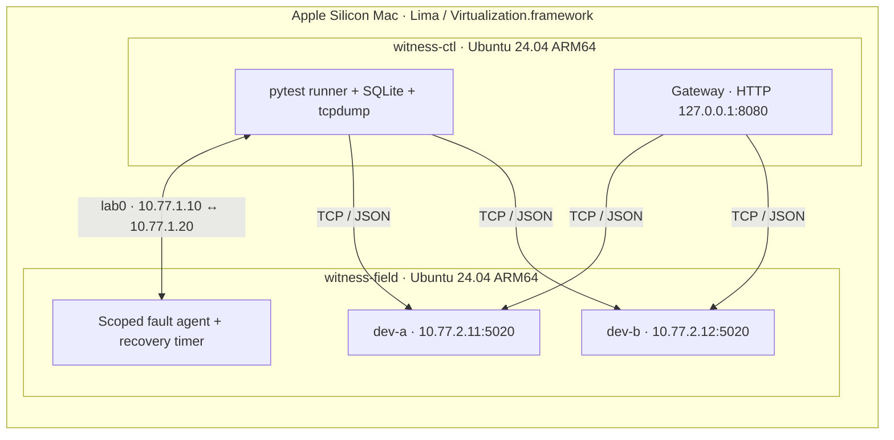

# Witness

**Linux device commissioning and fault injection, with evidence you can inspect.**

Witness checks whether a networked device is the expected device, speaks the right protocol, returns fresh data,
and recovers within its requirements. It distinguishes naming, routing, transport, protocol, identity, and data
failures instead of treating every missing response as the same timeout.

The devices are **Python simulations** of environmental sensors. TCP traffic, Linux services, routing, firewall
rules, packet delay, packet captures, and VM failures are real. This project does not test physical electronics
or embedded firmware.

**Release status: partial acceptance, 22/24 assertions.** Real-VM commissioning **11/11**, fault checks **24/24**,
and deliberately broken devices **6/6 detected** on the last tested functional revision. Five current-code
independent fresh-clone baselines (A14/A15) and fresh-VM reproduction remain **BLOCKED — HOST RESOURCES**.
The release rechecked the retained evidence; it did not repeat that VM campaign. There is no independent final
external sign-off. See the [final engineering report](docs/final-engineering-report.md).

[Architecture](#architecture) · [Faults and mutants](#faults-and-mutants) · [Try it](#try-it) ·
[Evidence](#evidence-and-acceptance) · [Engineering documents](#engineering-documents)

## Architecture



The controller routes `10.77.2.0/24` through the field VM. The field VM owns both device addresses on a dummy
interface (`field0`); forwarding is disabled because those destinations are local. Names resolve through the
controller's managed `/etc/hosts`. Removing the route, changing a name, stopping a process, and silently dropping
a SYN therefore produce different observable failures.

Management uses **AF_VSOCK SSH**, independent of the faulted network. Two private Lima user-v2 networks provide
connectivity; guest nftables rules, no default route, and no upstream DNS enforce isolation after provisioning.
Package installation uses a bounded temporary guest online window. Lab scripts do not change host routes or
host firewall rules. All lifecycle state stays in the repository's private `.lima.nosync` directory.

| Component | Responsibility |
|---|---|
| [Device](device/device.py) | systemd instances; bounded TCP sessions; strict newline-delimited JSON; IDENTIFY, HEALTH, READ |
| [Gateway](gateway/gateway.py) | Concurrent per-device polling every 2 s; inventory API; outage, freshness, restart, and recovery state |
| [Runner](runner/) | Observe, classify, check requirements, preserve attempts, and attribute failures to device, infrastructure, or runner |
| [Fault agent](scripts/faultctl.py) | Identity checks, allow-listed operations, forced-command SSH, 90 s fault dead-man rollback |
| [Evidence and reports](runner/report.py) | Normalized SQLite, environment snapshots, journals, packet evidence, requirement traceability, six SQL analyses |

The [protocol contract](docs/protocol.md) defines 4096-byte frames, exact JSON schemas, identity matching,
sequence and clock rules, and **11 outcome categories**. Connect/read timeouts are separate. One **30 s** budget
covers live case setup and decisions, including retries and gateway calls; bounded safety teardown follows.
A pass achieved only on retry is recorded as a failing **flake**. A partial baseline commissions nothing.

## Faults and mutants

The suite exercises **13 fault types, 21 fault variants, and 24 live fault-test instances**. An expected injected
failure passing its detection test never means the device was commissioned.

| Fault | Stimulus | Principal observation |
|---|---|---|
| F1 / F2 | Stopped / SIGSTOP-hung process | CONN_REFUSED / READ_TIMEOUT |
| F3 / F4 / F5 | Wrong port / unused address / missing route | CONN_REFUSED / CONNECT_TIMEOUT / NO_ROUTE |
| F6 | 300 ms or 3000 ms scoped netem; handshake or data delay | PASS_SLOW / CONNECT_TIMEOUT / READ_TIMEOUT |
| F7 | Wrong device name mapping or missing name | WRONG_IDENTITY / RESOLVE_FAIL |
| F8 / F9 | nftables DROP / TCP reset rejection | CONNECT_TIMEOUT / CONN_REFUSED or CONN_RESET |
| F10 / F11 | Malformed frames / mid-session FIN or RST | MALFORMED / CONN_RESET |
| F12 / F13 | Service restart / skewed clock or repeated sequence | Bounded recovery / STALE_DATA |

Six deliberate mutant builds return the wrong serial, reuse a sequence, omit the newline, echo the wrong ID,
report temperature as a string, or delay every seventh request. The real-VM campaign detected all six, with no
false alarms on the stock control device. Fault fixtures restore state; pre/postflight detects contamination.
Executed TERM/KILL experiments also verified dead-man recovery and independent capture expiry.

## Try it

No AI service or subscription is required. The [reproduction guide](docs/reproduction.md) separates three scopes:

### 1. Source and unit tests — no VMs

Use Python **3.12–3.14** and run from the repository root. The commands select `python3.14`;
substitute `python3.13` or `python3.12` if installed. macOS's bundled `python3` may be too old. With pyenv, select your installed supported version first:

```sh
python3.14 -m venv .venv
.venv/bin/python -m pip install -r requirements-dev.txt
.venv/bin/python -m pytest -q -p no:cacheprovider tests/unit tests/test_inventory.py handoff/tests/test_guest_verify.py
```

This source-only command covers 606 tests, including local sockets and synthetic evidence fixtures.
The additional 40 portable-package tests require the sealed release ZIP, as described in the reproduction guide.
These tests are not VM acceptance evidence.
The complete adversarial verifier is optional for a deeper source review:

```sh
.venv/bin/python scripts/verify_acceptance_contract.py --json contract-check.json
```

### 2. Two-VM demonstration — actual Linux traffic

Use a dedicated Apple Silicon Mac with Lima **2.2.0** (the validated version), AC power, and adequate resources.
Plan for **16 GiB RAM and 40 GiB free at entry**; measure actual peak requirements and maintain **10 GiB free**
throughout. This is a conservative starting budget, not qualification of every machine. An 8 GiB Mac is not
qualified for the full campaign. Review the [safety and recovery procedure](docs/commissioning-sop.md) first.

For a new checkout with no existing lab instances:

```sh
scripts/lab_vms.sh up
scripts/lab_vms.sh provision
scripts/lab_vms.sh provision
scripts/lab_vms.sh preflight
caffeinate -i scripts/lab_vms.sh suite baseline
caffeinate -i scripts/lab_vms.sh suite fault
scripts/lab_vms.sh report
scripts/lab_vms.sh fetch
scripts/lab_vms.sh preflight
scripts/lab_vms.sh stop
```

Expected test shapes are **11 commissioning checks** and **24 fault checks**. `report` also runs project acceptance:
exit **1** is expected before all campaign obligations are met. Run `fetch` afterward to retain the generated
reports and binary evidence. Do not suppress an unexpected test failure. Initial image download and provisioning
are additional work; this is not a promised ten-minute fresh installation.

The release pins the original Ubuntu image digest through its HTTPS archive endpoint. Native configuration
validation passed; new-image boot/provisioning on this final template remains unverified. Earlier fresh-VM and
clone trials predate the final functional repairs and are historical evidence only.

### 3. Full acceptance campaign

The [portable handoff](handoff/HANDOFF.md) implements provisioning twice, positive and negative controls, faults,
mutants, interruption/reset checks, five independent golden restorations, fresh-image VMs, and final evidence
verification. Its local packaging and native smoke checks passed. **Installation and end-to-end execution on a
recipient Mac remain untested.** The sealed reproduction ZIP is attached to the GitHub prerelease; its runtime
matches the last tested functional code. See [reproduction details](docs/reproduction.md) before using it.

## Evidence and acceptance

The latest functional campaign used `3d7a9f7` with clean guest source stamps. The release reran the production
acceptance command against that campaign's **actual SQLite database and complete evidence root**: **22/24**.
A14 (five fresh-clone baselines) and A15 (their stability) fail; ordinary restarts and older successful trials
do not satisfy them. Fresh-VM reproduction is an additional project obligation, not another assertion number.

The [acceptance contract](docs/acceptance-contract.md) derives obligations from the catalog, inventory, run plan,
and evidence directories. Deleting observations must not delete the obligation to produce them. Verification
checks file hashes, packet flows, results, attribution, selection, and commissioning completeness. Hashes establish
correspondence, not cryptographic authenticity or independent certification.

[Selected release evidence](evidence/release/README.md) contains small reports, command records, and provenance.
Full raw databases, captures, VM images, credentials, caches, and absolute evidence symlinks are excluded from GitHub.
The original repository and complete local evidence remain preserved. The published subset cannot independently
recalculate the historical acceptance score; new runs generate their own full stores.

This GitHub repository is a **sanitized publication snapshot** with an original-source manifest. The original
48-commit development history was retained locally rather than rewritten or uploaded. Historical audit **FAIL**
reports are retained, with any home-directory redaction explicitly recorded.

## Engineering documents

| Read | Purpose |
|---|---|
| [Final engineering report](docs/final-engineering-report.md) | Current results, release checks, resource decision, limitations |
| [Reproduction guide](docs/reproduction.md) | Source tests, VM demonstration, full campaign, artifact checks |
| [Requirements](docs/requirements.md) / [protocol](docs/protocol.md) / [inventory](inventory.yaml) | Testable contract and expected devices |
| [Commissioning SOP](docs/commissioning-sop.md) / [lab record](docs/lab-record.md) | Operator workflow, diagnosis, actual Linux configuration, recovery |
| [Clock root-cause report](docs/rca-001.md) | Served-clock drift, misleading first hypothesis, measured correction |
| [Overnight verification](docs/overnight-acceptance-20261021.md) | Final functional campaign, commands, timings, retained failures |
| [Independent audit](docs/independent-audit.md) / [re-audit](docs/independent-reaudit.md) | Historical FAIL findings and links to remediation |
| [Implementation ledger](docs/implementation-state.md) | Chronological decisions; older completion claims are explicitly superseded |
| [Original brief](PROJECT_BRIEF.md) | Immutable original scope; its initial status is historical |
